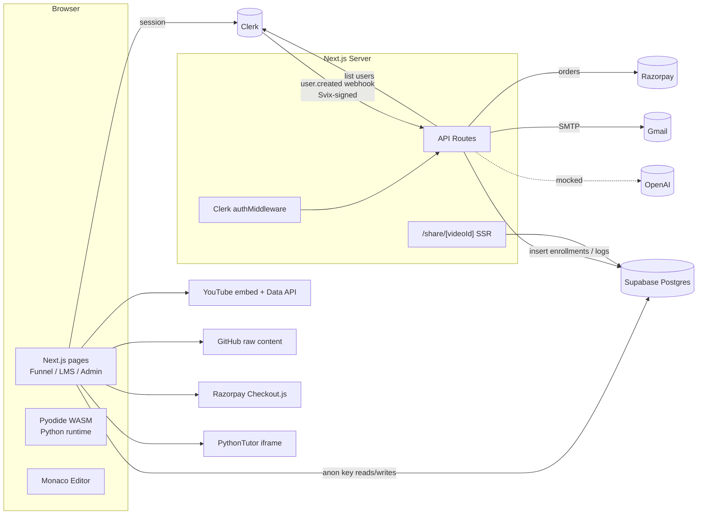

# Product Requirements Document (PRD) — Complete Platform

**Product Name:** TM – Digital Learning Experience Platform (public brand: *Shivam Academy*)
**Product URL:** [https://shivamnamdev.com/](https://shivamnamdev.com/)
**Repository:** `shivam-portfolio` (Next.js App Router)
**Prepared By:** Shivam Namdev
**Date:** October 16, 2026
**Document Type:** As-built product specification + PRD (derived from source code analysis)

> **How to read this document.** Sections 1–8 describe the product the way a PRD does: goals, users, capabilities, flows, requirements. Sections 9–13 describe how it is actually built today, including a status column on every requirement and a list of verified gaps. Feature-level PRDs ([Authentication](#55-authentication--access-control), [Course Discovery & Pricing](PRD_COURSE_DISCOVERY_PRICING_TESTING.md)) are summarised here and remain the deeper references for those modules.

---

## Table of Contents

1. [Product Overview](#1-product-overview)
2. [Business Objectives](#2-business-objectives)
3. [Target Users & Roles](#3-target-users--roles)
4. [Product Scope & Module Map](#4-product-scope--module-map)
5. [Core Features & Capabilities](#5-core-features--capabilities)
6. [User Flows](#6-user-flows)
7. [Functional Requirements](#7-functional-requirements)
8. [Non-Functional Requirements](#8-non-functional-requirements)
9. [System Architecture](#9-system-architecture)
10. [Pricing & Licensing](#10-pricing--licensing)
11. [Success Metrics (KPIs)](#11-success-metrics-kpis)
12. [Quality Assurance & Testing](#12-quality-assurance--testing)
13. [Known Issues, Risks & Mitigations](#13-known-issues-risks--mitigations)
14. [Future Enhancements](#14-future-enhancements)
15. [Appendices](#15-appendices)

---

## 1. Product Overview

TM – Digital Learning Experience Platform is a direct-to-learner EdTech product that combines four things in one Next.js application:

1. **A personal brand / portfolio site** for the instructor (home, about, mentorship, contact).
2. **A conversion funnel** — course catalog and long-form Video Sales Letter (VSL) pages with dual-currency pricing, coupons and Razorpay checkout.
3. **A Learning Management System (LMS)** — enrolled students watch cohort recordings, complete in-browser Python and Git practice labs, take an auto-graded final exam, discuss lessons, track streaks, and download a completion certificate.
4. **An admin back office** — CRM user directory, enrollments, student progress, code submission review, engagement analytics and manual ("backdoor") enrollment.

The teaching model is **live cohorts**: classes run on Google Meet, recordings are uploaded as unlisted YouTube videos, and the platform becomes the student's long-term home for recordings, labs and progress.

**Current catalog state (from [data/courses.ts](../data/courses.ts)):** three cohorts are defined — *Python Live Session (Batch 1)*, *Python Live Session (Batch 2)* and *Git Beginner Live Session (Batch 1)*. All three have `enrollmentClosed: true`, so the platform is currently in **delivery mode** (serving enrolled students) rather than **selling mode**. Opening a new cohort is a data change, not a code change.

---

## 2. Business Objectives

### Primary Goals

- **Convert visitors into paying cohort students** through persuasive, data-driven sales pages and a low-friction checkout.
- **Serve both Indian and international buyers** with INR and USD pricing on the same page.
- **Deliver a "hands-on" learning experience without installations**: code runs in the browser, so there are no server compute costs per student.
- **Drive completion and retention** through progress tracking, streaks, a leaderboard, exams and certificates.
- **Run the business as a solo operator** — content, coupons and courses are edited in TypeScript data files; admin tasks happen in one dashboard; notifications arrive by email.
- **Protect paid content** so only enrolled students reach recordings, labs and live-class links.

### Stakeholders

| Stakeholder | Interest |
|---|---|
| Instructor / Founder (Product Owner) | Revenue, student outcomes, brand |
| Marketing & Growth | Funnel conversion, lead capture, social sharing |
| Course & Learning team | Curriculum, assignments, exams, recordings |
| Admin Operations | Enrollments, offline payments, student support |
| Engineering / Platform | Reliability, integrations, deployments |
| QA & Test Automation | Regression safety of checkout, auth and LMS |
| Security & Compliance | Access control, payment integrity, PII handling |

---

## 3. Target Users & Roles

### Personas

| Persona | Description | Primary Goals |
|---|---|---|
| **Visitor / Prospect** | Beginner, student, career-switcher or working professional (IT and non-IT) browsing from India or abroad | Understand the course, price and outcomes; decide to buy |
| **Lead** | Signed-up user (Clerk account) who has not enrolled yet | Apply a coupon, buy, or request mentorship |
| **Enrolled Student** | Has a row in `user_enrollments` for a course | Watch recordings, practise, submit assignments, pass the exam, earn a certificate |
| **Admin (Instructor)** | Single configured admin identity | Monitor funnel and learning, grant access, review code |
| **API Tester** | Allow-listed email accounts | Explore the internal API via Swagger at `/api-docs` |

### Role & Access Matrix

| Capability | Visitor | Lead (signed in) | Enrolled Student | Admin |
|---|:-:|:-:|:-:|:-:|
| Public pages (`/`, `/about`, `/courses`, `/courses/[slug]`, `/contact`, `/mentorship`, legal) | ✅ | ✅ | ✅ | ✅ |
| Apply coupon / Buy / Enroll for free | ❌ (prompted to sign in) | ✅ | Shown "Go to Dashboard" | ✅ |
| `/learning` dashboard | ❌ | ✅ (empty state) | ✅ | ✅ |
| `/learning/[slug]` course player & labs | ❌ | ❌ Access denied | ✅ (own courses) | ✅ (all courses) |
| `/live/[slug]` live-class lobby | ❌ | ❌ Access denied | ✅ (own courses) | ✅ |
| Advanced (post-exam) videos | ❌ | ❌ | After passing exam (≥ 80%) | ✅ |
| `/admin` command center | ❌ | Redirected to `/learning` | Redirected to `/learning` | ✅ |
| `/api-docs` Swagger | ❌ | Only allow-listed emails | Only allow-listed emails | ✅ |

---

## 4. Product Scope & Module Map

| # | Module | Routes | Key Source |
|---|---|---|---|
| M1 | Brand & Marketing Site | `/`, `/about`, `/mentorship`, `/contact`, `/privacy`, `/terms`, `/refund` | [app/page.tsx](../app/page.tsx), [app/about/page.tsx](../app/about/page.tsx) |
| M2 | Course Catalog & VSL Sales Pages | `/courses`, `/courses/[slug]` | [app/courses/](../app/courses/), [components/HeroVSL.tsx](../components/HeroVSL.tsx) |
| M3 | Pricing, Coupons & Checkout | (embedded in sales page) + `/api/create-order`, `/api/verify-payment`, `/api/enroll-free` | [components/ActiveCohorts.tsx](../components/ActiveCohorts.tsx) |
| M4 | Authentication & Access Control | All protected routes, [middleware.ts](../middleware.ts), `/api/webhooks/clerk` | Clerk + Supabase |
| M5 | Learning Dashboard | `/learning` | [app/learning/page.tsx](../app/learning/page.tsx) |
| M6 | Course Player & Community | `/learning/[slug]` | [app/learning/[slug]/page.tsx](../app/learning/%5Bslug%5D/page.tsx) |
| M7 | Python Practice Lab (IDE) | `/learning/[slug]` → *Practice* tab | Pyodide + Monaco |
| M8 | Git Simulator Lab | `/learning/[slug]` → *Practice* tab (`labType: "git"`) | [components/GitGraphVisualizer.tsx](../components/GitGraphVisualizer.tsx) |
| M9 | Exams, Advanced Content & Certificates | `/learning/[slug]` | `exam_progress`, jsPDF |
| M10 | AI Code Tutor | `/api/ai-tutor` | [app/api/ai-tutor/route.ts](../app/api/ai-tutor/route.ts) |
| M11 | Live Class Lobby | `/live/[slug]` | [app/live/[slug]/page.tsx](../app/live/%5Bslug%5D/page.tsx) |
| M12 | Social Share Links | `/share/[videoId]` | [app/share/[videoId]/page.tsx](../app/share/%5BvideoId%5D/page.tsx) |
| M13 | Notifications & Engagement | Navbar bell, streaks, leaderboard, time tracker | [components/Navbar.tsx](../components/Navbar.tsx), [components/TimeTracker.tsx](../components/TimeTracker.tsx) |
| M14 | Admin Command Center (CRM) | `/admin` | [app/admin/page.tsx](../app/admin/page.tsx) |
| M15 | Lead Capture & Transactional Email | `/api/send-email`, webhook & payment emails | Nodemailer (Gmail SMTP) |
| M16 | Developer API Docs | `/api-docs` | [app/api-docs/page.tsx](../app/api-docs/page.tsx) |

---

## 5. Core Features & Capabilities

### 5.1. Brand & Marketing Site (M1)

The home page is a "bento grid" landing page that positions the instructor (QA leadership, Agentic AI, Python engineering) and routes traffic to three conversion paths: **Explore Courses**, **1-on-1 Mentorship**, and **In-Browser Practice Labs**.

- **About** (`/about`) — story-driven narrative ("The Dojo", "The Symphony", "The Code").
- **Mentorship** (`/mentorship`) — application form; submissions are emailed to the admin with subject *"NEW LEAD: 1-on-1 Mentorship Request"*. Promise: response within 24 hours.
- **Contact** (`/contact`) — general enquiry form, also emailed via `/api/send-email`.
- **Floating WhatsApp widget** — pre-filled `wa.me` chat link for sales questions.
- **Legal pages** — Privacy, Terms, Cancellation & Refund (no refunds once purchased; see §10).
- **SEO / Open Graph** — global metadata in [app/layout.tsx](../app/layout.tsx) (title, description, OG image, Twitter card, `en_IN` locale).

**Requirement Highlights**
- All marketing pages are public and indexable.
- Every lead form must deliver an email to the admin inbox with a reply-to set to the lead.

---

### 5.2. Course Catalog & VSL Sales Pages (M2)

Courses are defined entirely in [data/courses.ts](../data/courses.ts). Each entry automatically produces a catalog card on `/courses` and a full sales page on `/courses/[slug]`. Unknown slugs return a 404.

**Sales page sections (in order):**

| Section | Component | Data field |
|---|---|---|
| Hero / VSL headline, sub-headline, cover and flyer | `HeroVSL` | `vsl.*` |
| "Old way vs. New way" pain points | `PainPoints` | `painPoints.oldWay / newWay` |
| Six differentiator cards (mentorship, recordings, visualiser, etc.) | `Differentiators` | `differentiators[]` |
| Cohort box: status, offer, highlights, curriculum accordion, outcomes, bonuses, pricing, coupon, CTA, syllabus PDF | `ActiveCohorts` | `cohortHighlights`, `modules`, `outcomes`, `bonuses`, `pricing`, `resources` |
| Course-specific testimonials | inline | `courseTestimonials[]` |
| FAQ | `FAQ` | static |

**Catalog card states:** open cohorts show the current INR price with a highlighted status badge; closed cohorts show "Closed" in a muted style.

**Requirement Highlights**
- Adding a course to `data/courses.ts` must create its catalog card and sales page with no code changes.
- Closed cohorts must not offer a purchase CTA.
- Syllabus PDFs are downloadable without sign-in.

---

### 5.3. Pricing, Currency & Coupons (M3)

- **Region toggle:** 🇮🇳 India (INR) / 🌎 International (USD). Default is INR. Prices, strikethrough "original price" and savings text update instantly.
- **Coupons** are defined in [data/coupons.ts](../data/coupons.ts):
  - `discountType: "percentage"` — `discountValue` is a number (e.g. 20 → 20% off).
  - `discountType: "fixed"` — `discountValue` is a per-currency map `{ inr, usd }`.
  - `allowedUsers` — empty list = public coupon; otherwise restricted to specific Clerk user IDs.
- **Coupon UX:** the user must be signed in to apply a coupon. Messages: *"Invalid coupon code."*, *"This coupon is restricted to specific accounts."*, *"Coupon applied successfully!"*.
- **Price rules:** the discounted price is rounded and floored at 0 in the UI and in `/api/enroll-free`; `/api/create-order` floors paid orders at 1 currency unit.
- **The server recalculates the price.** The client-sent amount is ignored; the server works out the price again from `courseId`, `currency` and `couponCode`.

---

### 5.4. Checkout, Payments & Fulfilment (M3)

**CTA state machine on the sales page:**

| Condition | CTA shown |
|---|---|
| Cohort `enrollmentClosed` and user not enrolled | "Enrollment Closed" → link back to catalog |
| User already enrolled (Supabase check) | "You are Enrolled! Go to Dashboard" |
| Final price = 0 | "Enroll for Free" |
| Otherwise | "Buy Now (INR)" / "Buy Now (USD)" |
| Request in flight | "Processing…" (disabled) |
| Not signed in, CTA clicked | Alert, then Clerk sign-in modal |

**Paid path (Razorpay):**
1. Client loads `checkout.razorpay.com/v1/checkout.js`.
2. `POST /api/create-order` → server prices the order and creates a Razorpay order (`amount × 100`, receipt `rcpt_<timestamp>`).
3. The Razorpay overlay opens, pre-filled with the user's name and email, in amber theme.
4. On success, `POST /api/verify-payment` checks the HMAC-SHA256 signature of `order_id|payment_id` against the secret.
5. On a valid signature: insert into `user_enrollments`, log to `admin_activity_log`, and send a **Welcome + Receipt email** (order ID, amount, PAID status, private WhatsApp group link, dashboard link; BCC to admin).
6. A success modal shows **Join WhatsApp Group** and **Go to Dashboard**.

**Free path (100% coupon):** `POST /api/enroll-free` calculates the price again on the server, refuses the request if the price is above 0, then inserts the enrollment and logs the activity. The same success modal is shown. No email is sent on this path.

**Offline path:** payments made by UPI or other offline methods are fulfilled by the admin through **Manual Enrollment** (§5.14).

---

### 5.5. Authentication & Access Control (M4)

*Detailed in the Authentication PRD (Sept 3, 2026); summarised and checked against the code here.*

| Layer | Implementation |
|---|---|
| Identity provider | Clerk (`@clerk/nextjs` v4): Google OAuth + email/password, `<SignInButton>`, `<UserButton>` |
| Route protection | `authMiddleware` in [middleware.ts](../middleware.ts). Everything is **protected by default**; only listed `publicRoutes` are open; `/api/webhooks/clerk` is in `ignoredRoutes` |
| Enrollment authorization | Client-side Supabase query on `user_enrollments` (`user_id` + `course_slug`) before showing `/learning/[slug]` and `/live/[slug]`. The share route does the same check **on the server** |
| Admin authorization | Primary email compared against a hard-coded `ADMIN_EMAIL` constant (in admin, learning player, live lobby, share route, navbar) |
| Identity sync | Clerk `user.created` webhook, verified with **Svix** headers (`svix-id`, `svix-timestamp`, `svix-signature`) → admin activity log + welcome email to student + alert email to admin |

**Public routes:** `/`, `/courses(.*)`, `/about`, `/privacy`, `/terms`, `/refund`, `/contact`, `/mentorship`, `/share(.*)`, plus API routes `create-order`, `verify-payment`, `enroll-free`, `send-email`, `ai-tutor`, `get-clerk-users`, `get-all-users`.

**Requirement Highlights**
- Any route not on the whitelist must require a Clerk session.
- Learning content and live links render only after the enrollment check confirms access.
- Admin-only screens and data must be restricted to the admin identity, **on the server as well as in the UI** (see gap S2 in §13).

---

### 5.6. Learning Dashboard — `/learning` (M5)

- Personal greeting and **Total XP** counter.
- **My Enrolled Courses**: one card per enrollment with **Join Live Class** (→ `/live/[slug]`) and **View Recordings** (→ `/learning/[slug]`). Users with no enrollments see an empty state with **Browse Catalog**.
- **Daily streak 🔥**: on each visit the streak goes up by 1 if the user was last active yesterday and resets to 1 after a gap. The row is stored in `user_stats` and created on first visit.
- **Global leaderboard**: top 5 by `total_points`, with internal/test accounts filtered out by email.
- **Resources**: course syllabus download.

---

### 5.7. Course Player & Community — `/learning/[slug]` (M6)

- **Curriculum sidebar** built from [data/learning-content.ts](../data/learning-content.ts): modules → lessons. Each lesson shows its state (played, completed ✅, document 📄, locked 🔒) and its assignment status (📝 Pending / ✅ Submitted / 🏆 Final Exam).
- **YouTube metadata**: titles, descriptions and durations are fetched in bulk from the YouTube Data API v3 (`NEXT_PUBLIC_YOUTUBE_API_KEY`).
- **Document lessons**: IDs starting with `doc-` are rendered as downloadable resources (cheat sheets, PDFs) instead of videos.
- **Resume playback**: the last video and timestamp are kept in `localStorage` per course and restored on return.
- **Progress bar**: (videos completed + assignments submitted) ÷ (total videos + total assignments).
- **Mark as Complete** writes to `video_progress` (honour system; watch time is not checked).
- **Tabs**: Details · Q&A · Materials · Practice · Visualize.
- **Q&A**: per-video discussion threads stored in `video_comments`, showing name and avatar.
- **Likes**: per-video likes in `video_likes`.
- **Share**: generates `/share/<youtubeId>` links that render rich WhatsApp/LinkedIn previews (§5.12).
- **Coming-soon state**: courses with no uploaded videos show a placeholder.

---

### 5.8. Python Practice Lab (M7)

A "KodeKloud-style" IDE that runs **entirely in the browser**.

| Capability | Detail |
|---|---|
| Editor | `@monaco-editor/react` (VS Code engine), Python syntax, with autocomplete suggestions computed by Pyodide |
| Runtime | **Pyodide v0.25.0** (CPython → WebAssembly) loaded from jsDelivr; no server execution cost |
| `input()` support | `input()` is overridden to use a native browser `prompt()` |
| Virtual file system | Create, edit and delete several files (e.g. `main.py`, `utils.py`, `data.csv`); files sync with the Pyodide FS before and after each run |
| Multi-step assignments | Instructions fetched from GitHub raw URLs (`rawUrl`) and split into paginated steps; each step keeps its own files |
| Starter code | Optional `starterCodeUrl`; `carryOverCode: true` carries the previous lesson's code forward |
| Draft autosave | Per-video drafts saved to `localStorage`; on return, restored from the draft or from the last DB submission |
| Hidden tests | Optional `testCode` (Python `assert`/regex grader) runs after the student's code |
| Submit | Upserts into `assignment_progress` (unique on `user_id, course_slug, video_id`) and logs a `submission` event for the admin |
| Official solution | **View Solution** opens a side-by-side modal comparing the student's code with `solutionUrl` |
| Expected outcome | Optional `expectedOutcomeUrl` modal |
| Visualizer | Embedded **PythonTutor** iframe (colour-inverted for dark mode) to step through execution |
| AI Tutor | **Ask AI Tutor** sends code, output and assignment context to `/api/ai-tutor` (§5.10) |

---

### 5.9. Git Simulator Lab (M8)

Assignments with `labType: "git"` replace the Python IDE with a **simulated Git terminal** and a live commit graph.

- **Inputs from GitHub:** `instructionsUrl` (Markdown), `starterRepoUrl` (seed JSON), `expectedStateUrl`, `validatorUrl`, `solutionUrl`.
- **Supported commands:** `git init`, `status`, `add`, `commit -m`, `log` / `log --oneline`, `branch`, `checkout` / `checkout -b`, `merge`, `diff`, `remote add` / `remote -v`, `push`, `pull`, `stash` / `stash pop`, plus `touch`, `ls`, `clear`. Anything else returns a help message listing the supported commands.
- **Visualize tab:** `GitGraphVisualizer` (`@gitgraph/react`) draws commits and branches as the student works.
- **Submission:** the command history, repo state, step index and timestamp are serialised as JSON into `assignment_progress.submitted_code`.

---

### 5.10. Exams, Advanced Content, AI Tutor & Certificates (M9, M10)

**Final Foundation Certification Exam** (`isExam: true`):
- A 5-question practical exam (lists, strings, dictionaries/payroll, etc.), 20 points per question, auto-graded by an embedded Python grader that checks the student's stdout and globals.
- **Pass mark 80%**, **maximum 5 attempts** (the admin has no limit). Results are stored in `exam_progress` (`attempts_used`, `is_passed`, `last_score`, `completed_at`).
- Passing **unlocks modules marked `isAdvancedModule: true`**; until then those lessons show 🔒.

**AI Code Tutor** (`/api/ai-tutor`):
- Intended behaviour: act as a "Senior QA Lead" that gives hints from the student's code, the assignment and the error, **without revealing the answer**.
- **Current state: mock / test mode.** The OpenAI client is set up but not called. The route waits 1.2 s and returns rule-based hints (Python `SyntaxError`, `NameError`, empty editor; Git "nothing to commit", unsupported command).

**Certificate of Completion:**
- The **Certificate** button appears at **100% course progress** (always visible to the admin).
- The PDF is generated **client-side with jsPDF** (A4 landscape, dark theme, amber borders, student name in capitals).
- A server-side generator (`POST /api/generate-certificate`, `pdf-lib`, ID format `SN-PY-<year>-<rand>`) exists, but **nothing in the UI calls it**.

---

### 5.11. Live Class Lobby — `/live/[slug]` (M11)

- Checks enrollment (the admin always has access), then shows a "Secure Lobby" with an **Enter Google Meet** button driven by the course's `liveLink`.
- Shows "No live link configured" when `liveLink` is absent. It is currently commented out for all cohorts, since all are closed.
- Pre-class checklist: join 5–10 minutes early, stable internet, notebook ready, recordings available next morning.
- Non-enrolled users see **Access Denied** with a link back to the dashboard.

---

### 5.12. Social Share Links — `/share/[videoId]` (M12)

- A public route (so WhatsApp and LinkedIn crawlers can read it) that produces **dynamic Open Graph metadata**: the lesson title, the course title and the YouTube thumbnail (`img.youtube.com/vi/<id>/0.jpg`, which works for unlisted videos).
- Destination is resolved **on the server**: not signed in → course sales page; admin or enrolled → `/learning/[slug]?v=<videoId>`; otherwise → sales page. Errors default to deny.
- Returns a 200 page with a JavaScript redirect, so bots see the metadata and humans are forwarded.

---

### 5.13. Notifications & Engagement (M13)

- **Navbar notification bell** (signed-in users): platform announcements from [data/notifications.ts](../data/notifications.ts), typed `alert` / `feature` / `event`, each with an optional deep link. Unread count = total − the "read count" kept in `localStorage`; **Mark all as read** is supported.
- **Admin activity log** (`admin_activity_log`): `signup`, `enrollment` and `submission` events written by the webhook, the payment/free-enroll APIs, manual enrollment and assignment submission.
- **Time tracker**: an invisible component that, on `/learning*` pages and only while the tab is visible, sends a 60-second heartbeat to add to `user_stats.total_time_seconds` (see issue B1 in §13).
- **Streaks and XP**: see §5.6.

---

### 5.14. Admin Command Center — `/admin` (M14)

Restricted to the configured admin email. Anyone else is redirected (signed-out users → `/`, other users → `/learning`).

**KPI cards:** Total Leads (Clerk users) · Enrollments · Coupons Used.

**Tabs:**

| Tab | Content |
|---|---|
| User Directory (CRM) | All Clerk users (up to 100): avatar, name, email, Clerk ID, joined date, **Enrolled / Lead** badge |
| Enrollments | Student identity (taken from CRM data), course, coupon used, enrollment date |
| Student Progress | Videos done / total, assignments done / total, completion % bar |
| Code Submissions | Student, assignment title, timestamp, **View Code** → read-only Monaco modal |
| Engagement ⏱️ | Total time spent, current streak, last active date |

**Manual Enrollment / Backdoor:** enter a Clerk User ID and pick a course → duplicate check → insert into `user_enrollments` → activity log entry "Backdoor access granted". Used for offline (UPI) payments and scholarships.

---

### 5.15. Lead Capture & Transactional Email (M15)

| Trigger | Recipient | Content |
|---|---|---|
| Contact / Mentorship / Lead-magnet form → `/api/send-email` | Admin (reply-to = lead) | Subject + name, email, message |
| New Clerk signup (webhook) | Student | Branded welcome email + "Browse Courses" CTA |
| New Clerk signup (webhook) | Admin | "NEW USER SIGNUP" alert with name, email, Clerk ID |
| Verified Razorpay payment | Student (BCC admin) | Welcome + transaction receipt + private WhatsApp group link + dashboard link |

Transport: Nodemailer over Gmail SMTP using `GMAIL_USER` and `GMAIL_APP_PASSWORD`. Email failures are logged and **never block** enrollment.

---

### 5.16. Developer API Docs — `/api-docs` (M16)

An in-app **Swagger UI** (OpenAPI 3.0 spec defined inline) covering `send-email`, `create-order`, `verify-payment`, `enroll-free`, `ai-tutor`, `get-clerk-users`, `get-all-users` and `webhooks/clerk`. Access is limited to an allow-list of tester emails.

---

## 6. User Flows

### 6.1. Visitor → Paid Student

1. Visitor lands on `/` or a shared link and goes to `/courses` → `/courses/[slug]`.
2. Reads the VSL, pain points, differentiators, curriculum and testimonials; may download the syllabus PDF.
3. Picks a region (INR/USD); optionally signs in and applies a coupon.
4. Clicks **Buy Now**. If not signed in, the Clerk modal opens and the user returns to the page afterwards.
5. `/api/create-order` → Razorpay overlay → payment.
6. `/api/verify-payment` → enrollment row + admin log + welcome/receipt email.
7. Success modal → joins the WhatsApp group → **Go to Dashboard** → `/learning`.

### 6.2. Free-Coupon Enrollment

1. Signed-in user applies a coupon that brings the price to 0.
2. The CTA changes to **Enroll for Free**.
3. `/api/enroll-free` checks the price again on the server → enrollment row + admin log.
4. Success modal → dashboard.

### 6.3. Returning Enrolled Student

1. Student signs in and opens `/courses/[slug]` → the CTA shows **You are Enrolled! Go to Dashboard**.
2. `/learning` → streak updated → **View Recordings** → the player resumes the last video at the saved timestamp.

### 6.4. Daily Learning Loop

1. Watch the lesson → **Mark as Complete**.
2. Open **Practice** → read the step instructions → write code → **Run** (Pyodide) → hidden tests give feedback.
3. If stuck: **Ask AI Tutor**, **Visualize** (PythonTutor / Git graph) or **View Solution**.
4. **Submit** → `assignment_progress` upsert → the admin sees it in *Code Submissions*.
5. Ask or answer questions in **Q&A**; like or share the lesson.

### 6.5. Exam → Advanced Unlock → Certificate

1. Student opens the Final Exam lesson → loads starter code → writes solutions → **Submit Exam (n/5)**.
2. The grader prints a score. **≥ 80%**: toast "EXAM PASSED", advanced lessons unlock. **< 80%**: toast with remaining attempts.
3. When progress reaches 100% → **Certificate** → PDF downloaded.

### 6.6. Live Class

1. Dashboard → **Join Live Class** → `/live/[slug]` → enrollment verified → **Enter Google Meet**.

### 6.7. Admin Manual Enrollment

1. Admin opens `/admin` → finds the student in the *User Directory* → copies the Clerk ID.
2. **Manual Enrollment** → picks the course → **Grant Access** → enrollment row + activity log.

### 6.8. New Signup (System Flow)

1. User signs up in Clerk → Clerk sends a `user.created` webhook → Svix signature verified.
2. Row added to `admin_activity_log` (`signup`) → welcome email to the student → alert email to the admin.

### 6.9. Shared Lesson Link

1. A student shares `/share/<videoId>` on WhatsApp → the crawler reads the OG tags (thumbnail + title).
2. The recipient clicks → the server resolves access → enrolled users go to the lesson, everyone else goes to the sales page.

---

## 7. Functional Requirements

Status key: ✅ Implemented · 🟡 Partial / has caveats · 🔴 Not implemented or broken

| ID | Module | Requirement | Priority | Status |
|---|---|---|---|---|
| FR1 | M2 | Generate catalog cards and sales pages from `data/courses.ts` | Must | ✅ |
| FR2 | M2 | Unknown course slug returns 404 | Must | ✅ |
| FR3 | M3 | Toggle INR/USD pricing across the cohort box and CTA | Must | ✅ |
| FR4 | M3 | Validate coupons (existence, user restriction) with clear messages | Must | ✅ |
| FR5 | M3 | Server re-computes the final price; never trusts the client amount | Must | ✅ |
| FR6 | M3 | Correctly handle decimal USD prices (e.g. `$9.99`) | Must | ✅ (fixed B2) |
| FR7 | M3 | Free-coupon bypass skips Razorpay and enrolls instantly | Must | ✅ |
| FR8 | M3 | Verify Razorpay signature before enrolling | Must | ✅ |
| FR9 | M3 | Enrollment must match the course that was actually paid for | Must | ✅ (fixed S3) |
| FR10 | M3 | Reject purchase/enrollment for closed cohorts on the server | High | ✅ (fixed S4) |
| FR11 | M3 | Enrollment insert is idempotent (no duplicate rows) | High | ✅ app-level; DB constraint in [SUPABASE_HARDENING.md](SUPABASE_HARDENING.md) |
| FR12 | M3 | Show "Go to Dashboard" for already-enrolled users | Must | ✅ |
| FR13 | M4 | Non-whitelisted routes require a Clerk session | Must | ✅ |
| FR14 | M4 | Enrollment-gated access to course player and live lobby | Must | 🟡 client-side check only |
| FR15 | M4 | Admin-only UI **and** APIs restricted to the admin identity | Must | 🟡 APIs ✅; dashboard table reads still use the anon key |
| FR16 | M4 | Clerk webhook verified via Svix; invalid payloads rejected (400) | Must | ✅ |
| FR17 | M4 | Webhook handles user updates/deletions | Medium | 🔴 only `user.created` |
| FR18 | M5 | Show enrolled courses, streak, XP, leaderboard | Must | ✅ (fixed B3) |
| FR19 | M6 | Fetch lesson metadata from YouTube; support document lessons | Must | ✅ |
| FR20 | M6 | Resume last video and timestamp | High | ✅ |
| FR21 | M6 | Mark lesson complete; compute course progress | Must | ✅ (honour system) |
| FR22 | M6 | Per-lesson Q&A and likes | High | ✅ |
| FR23 | M7 | Run Python in the browser with multi-file VFS and `input()` | Must | ✅ |
| FR24 | M7 | Multi-step assignments fetched from GitHub | Must | ✅ |
| FR25 | M7 | Hidden auto-grading tests | High | ✅ |
| FR26 | M7 | Persist submissions; restore drafts | Must | ✅ |
| FR27 | M7 | Solution comparison and code visualizer | Medium | ✅ |
| FR28 | M8 | Simulated Git terminal with commit-graph visualizer | High | ✅ |
| FR29 | M9 | Final exam: 80% pass, 5 attempts, unlock advanced lessons | High | ✅ (client-side grading) |
| FR30 | M9 | Certificate at 100% completion | High | ✅ (no verifiable ID / registry) |
| FR31 | M10 | AI tutor gives contextual hints from a real LLM | High | 🔴 mock mode |
| FR32 | M11 | Live lobby shows Meet link only to enrolled students | Must | ✅ |
| FR33 | M12 | Share links render rich previews and route by access | High | ✅ |
| FR34 | M13 | Track active learning time per student | Medium | ✅ (fixed B1) |
| FR35 | M13 | Platform announcements with unread count | Medium | ✅ (static data) |
| FR36 | M14 | Admin CRM, enrollments, progress, submissions, engagement | Must | ✅ (CRM limited to 100 users) |
| FR37 | M14 | Manual enrollment with duplicate check and audit log | Must | ✅ |
| FR38 | M15 | Lead forms email the admin; payment and signup emails to students | Must | ✅ |
| FR39 | M15 | Free-enrollment confirmation email | Medium | 🔴 |
| FR40 | M16 | Swagger docs restricted to allow-listed testers | Low | ✅ (UI-level) |

---

## 8. Non-Functional Requirements

| Category | Requirement | Current Notes |
|---|---|---|
| Performance | Public pages are static/SSR and render in < 2 s on 4G; currency toggle and coupon feedback < 100 ms | Coupon logic runs locally in the client |
| Performance | Code execution adds no server load | Pyodide runs on the client; ~10 MB first-load download (cached afterwards) |
| Security | All authorization decisions for paid content and admin data are enforced on the server | **Not met** — see §13 S1–S5 |
| Security | Payment integrity: signature verification + server-side pricing | Signature ✅; order ↔ course binding ❌ |
| Security | Secrets only in environment variables; never sent to the client except `NEXT_PUBLIC_*` | ✅ |
| Privacy | PII (names, emails) visible only to the admin | 🟡 user-list APIs admin-only; Supabase tables still anon-readable |
| Reliability | Email / logging failures must never block enrollment | ✅ wrapped in try/catch |
| Reliability | Access checks fail closed (deny on error) | ✅ in share route and player |
| Scalability | Supports growth beyond 100 users in admin CRM | ✅ paginated (up to 5,000) |
| Usability | Mobile-responsive, dark theme across funnel and LMS | ✅ (admin and live lobby use a light theme) |
| Accessibility | Role-based, labelled controls (also used by Playwright locators) | 🟡 partial |
| Maintainability | Courses, coupons, curriculum and notifications are editable as data | ✅ |
| Maintainability | Builds fail on type or lint errors | 🟡 type errors now fail the build; ESLint not installed yet |
| Observability | Key business events are logged | 🟡 `admin_activity_log` + `console.error`; no APM |

---

## 9. System Architecture

### 9.1. Technology Stack

| Layer | Technology |
|---|---|
| Framework | Next.js `^14.2` (App Router), React 18, TypeScript 5 |
| Styling / Motion | Tailwind CSS 3, Framer Motion 11, Lucide icons, Google Fonts (Inter, Space Grotesk, JetBrains Mono) |
| Auth | Clerk (`@clerk/nextjs` ^4.29, `authMiddleware`) |
| Database | Supabase (PostgreSQL) via `@supabase/supabase-js` with the **anon key** (browser and server) |
| Payments | Razorpay Orders API + Checkout.js |
| Email | Nodemailer → Gmail SMTP |
| Webhook verification | Svix |
| Video | YouTube (unlisted) iframe + IFrame API + Data API v3 |
| In-browser runtime | Pyodide 0.25.0 (WebAssembly CPython) |
| Editor | Monaco (`@monaco-editor/react`) |
| Visualizers | PythonTutor (iframe), `@gitgraph/react` |
| PDF | jsPDF (client certificate), pdf-lib (unused server certificate) |
| AI | `openai` SDK (configured, currently mocked) |
| API docs | `swagger-ui-react` |
| Testing / CI | Playwright 1.59 (Chromium, Firefox, WebKit), GitHub Actions |
| Hosting | Vercel (implied by tests/README and deployment notes) |
| Content hosting | GitHub raw (assignments/solutions), AWS S3 (cheat sheets), `/public` (flyers, syllabi) |

### 9.2. High-Level Architecture

### 9.3. Route Inventory

| Route | Type | Access |
|---|---|---|
| `/` | Server page | Public |
| `/about`, `/contact`, `/mentorship`, `/privacy`, `/terms`, `/refund` | Pages | Public |
| `/courses`, `/courses/[slug]` | Server pages + client cohort box | Public |
| `/share/[videoId]` | Server page (dynamic metadata + redirect) | Public |
| `/learning` | Client page | Signed-in |
| `/learning/[slug]` | Client page | Signed-in + enrolled (or admin) |
| `/live/[slug]` | Client page | Signed-in + enrolled (or admin) |
| `/admin` | Client page | Signed-in + admin email (client check) |
| `/api-docs` | Client page | Signed-in + allow-listed emails (client check) |

### 9.4. API Inventory

| Method & Path | Middleware | Purpose | Server-side checks |
|---|---|---|---|
| `POST /api/create-order` | Public | Price the order and create a Razorpay order (buyer + course stored in order `notes`) | Clerk session (or `x-api-key` outside production); course exists and open; coupon valid / allowed user |
| `POST /api/verify-payment` | Public | Verify signature → enroll → log → email | Clerk session; constant-time HMAC check; order re-fetched from Razorpay and its `notes.userId` must match the caller |
| `POST /api/enroll-free` | Public | 100%-coupon enrollment | Clerk session; course open; server-side price must equal 0 |
| `POST /api/send-email` | Public | Lead / contact email to admin | Email format, length caps, HTML escaping, honeypot |
| `POST /api/ai-tutor` | Public | Hints for Python/Git labs | None (mock responses) |
| `POST /api/get-clerk-users` | Protected | Resolve Clerk IDs → name/email/avatar | Admin (server-side) |
| `GET /api/get-all-users` | Protected | Full Clerk user list (paginated) | Admin (server-side) |
| `POST /api/admin/enroll` | Protected | Manual (offline-payment) enrollment | Admin (server-side); Clerk user must exist; idempotent |
| `POST /api/xp/sync` | Protected | Recompute XP from progress rows | Clerk session |
| `POST /api/generate-certificate` | Protected | Server-generated certificate PDF | Session (via middleware); unused by UI |
| `POST /api/webhooks/clerk` | Ignored by Clerk | Signup sync | Svix signature |
| `POST /api/track-time` | Protected | Add seconds to `user_stats.total_time_seconds` | `getAuth()` user; 1–60 s per ping |

### 9.5. Data Model (Supabase)

| Table | Purpose | Key Columns | Written By |
|---|---|---|---|
| `user_enrollments` | Who owns which course | `id`, `user_id` (Clerk), `course_slug`, `coupon_used`, `user_name`, `user_email`, `enrolled_at` | verify-payment, enroll-free, admin backdoor |
| `video_progress` | Completed lessons | `user_id`, `course_slug`, `video_id`, `completed_at` — unique (user, course, video) | Player |
| `assignment_progress` | Code / Git submissions | `user_id`, `user_name`, `course_slug`, `video_id`, `submitted_code`, `completed_at` — unique (user, course, video) | Player (upsert) |
| `exam_progress` | Final-exam attempts | `user_id`, `course_slug`, `attempts_used`, `is_passed`, `last_score`, `completed_at` — unique (user, course) | Player (upsert) |
| `video_comments` | Lesson Q&A | `video_id`, `user_id`, `user_name`, `user_image`, `content`, `created_at` | Player |
| `video_likes` | Lesson likes | `video_id`, `user_id` | Player |
| `user_stats` | Gamification & engagement | `user_id`, `user_name`, `user_email`, `current_streak`, `last_active_date`, `total_points`, `total_time_seconds` | Dashboard, `/track-time` |
| `admin_activity_log` | Admin notification feed | `type` (`signup` / `enrollment` / `submission`), `message`, `user_email` | Webhook, payment APIs, admin, player |

> [docs/DATABASE.md](DATABASE.md) documents only the first four tables and is missing several columns. This table supersedes it.

### 9.6. Content Model (Data-as-Code)

| File | Shape | Drives |
|---|---|---|
| [data/courses.ts](../data/courses.ts) | `activeCourses[]`: `id`, `slug`, `title`, `statusText`, `demoOffer`, `duration`, `enrollmentClosed`, `liveLink?`, `whatsappLink`, `vsl{}`, `painPoints{}`, `pricing{inr,usd}`, `resources{}`, `differentiators[]`, `cohortHighlights[]`, `courseTestimonials[]`, `outcomes[]`, `bonuses[]`, `modules[]` | Catalog, sales pages, checkout, live lobby, emails |
| [data/coupons.ts](../data/coupons.ts) | `activeCoupons[]`: `code`, `discountType`, `discountValue`, `allowedUsers[]` | Coupon UI + server pricing |
| [data/learning-content.ts](../data/learning-content.ts) | `courseCurriculumMap[slug] = modules[]` with `moduleTitle`, `videoIds[]`, `isAdvancedModule?`, `githubAssignments{videoId → {title, rawUrl, solutionUrl, starterCodeUrl?, expectedOutcomeUrl?, testCode?, isExam?, carryOverCode?, labType?, instructionsUrl?, starterRepoUrl?, expectedStateUrl?, validatorUrl?}}`, `resources{}` | Player, labs, exam, admin progress totals, share titles |
| [data/notifications.ts](../data/notifications.ts) | `platformNotifications[]`: `id`, `title`, `message`, `date`, `type`, `link?` | Navbar bell |
| [data/testimonials.ts](../data/testimonials.ts) | Global testimonials | Marketing sections |

**Current content inventory (approximate):**

| Course | Modules | Video lessons | Doc lessons | Assignments | Notes |
|---|---|---|---|---|---|
| `python-beginners` (Batch 1) | 6 | 33 | 0 | ~29 | Includes the Final Exam and 1 advanced (locked) video |
| `python-beginners-batch-2` | 5 | 25 | 1 | ~22 | Module 5 is empty (placeholder) |
| `git-beginner-batch-1` | 5 | 16 | 1 | 2 Git labs | Modules 3–5 have no labs yet |

### 9.7. Configuration (Environment Variables)

| Variable | Scope | Used By |
|---|---|---|
| `NEXT_PUBLIC_CLERK_PUBLISHABLE_KEY`, `CLERK_SECRET_KEY` | Client / Server | Clerk |
| `CLERK_WEBHOOK_SECRET` | Server | Svix verification |
| `NEXT_PUBLIC_SUPABASE_URL`, `NEXT_PUBLIC_SUPABASE_ANON_KEY` | Client / Server | Supabase client |
| `SUPABASE_SERVICE_ROLE_KEY` | Server | Defined but **not used** in code |
| `RAZORPAY_KEY_ID`, `RAZORPAY_KEY_SECRET`, `NEXT_PUBLIC_RAZORPAY_KEY_ID` | Server / Client | Payments |
| `GMAIL_USER`, `GMAIL_APP_PASSWORD` | Server | Email |
| `NEXT_PUBLIC_YOUTUBE_API_KEY` | Client | YouTube metadata |
| `OPENAI_API_KEY` | Server | AI tutor (currently unused) |
| `ADMIN_API_KEY` | Server | API test bypass header `x-api-key` |

---

## 10. Pricing & Licensing

### 10.1. Course Pricing (as configured)

| Course | INR (current / original) | USD (current / original) | Status |
|---|---|---|---|
| Git Beginner Live Session (Batch 1) — 2–3 weeks, weekdays | ₹399 / ₹799 | $9.99 / $19.99 | Cohort completed |
| Python Live Session (Batch 2) — 6–8 weeks, weekends, max 20 learners | ₹1,999 / ₹2,499 | $25 / $35 | Cohort completed |
| Python Live Session (Batch 1) — 30 sessions / 45 days | ₹599 / ₹899 | $150 / $250 | Cohort completed |

### 10.2. Commercial Model

- **One-time purchase per cohort.** No subscriptions, EMIs or bundles.
- **Lifetime-style access** to recordings, labs and community for enrolled students (no expiry logic exists).
- **Coupons:** percentage or fixed per-currency discounts, public or locked to specific accounts. Coupon usage is tracked per enrollment (`coupon_used`) and summarised in the admin KPIs.
- **Certificates** are included for learners who finish the course; the marketing copy also mentions attendance/assignment criteria (e.g. 75% attendance) that are applied manually.
- **Bonuses:** e.g. high scorers get access to Advanced Python recordings (implemented as exam-gated advanced modules).
- **Refund policy:** no refunds once a purchase is completed, because access to digital materials is immediate ([app/refund/page.tsx](../app/refund/page.tsx)).
- **Authentication** is a core, free capability for all users and is not a paid add-on.

---

## 11. Success Metrics (KPIs)

**Acquisition & Conversion**
- Visitor → sign-up rate (Clerk users ÷ unique visitors)
- Sign-up → enrollment rate (admin *Leads vs Enrolled*)
- Sales-page CTA click-through and Razorpay checkout completion rate
- Coupon redemption rate and revenue impact per coupon
- Lead-form submissions (contact, mentorship, cheat sheet)
- Share-link click-throughs (`/share/*`)

**Learning & Engagement**
- Course completion rate (100% progress) and certificates issued
- Assignment submission rate per lesson; median time to submit
- Exam pass rate, average attempts to pass
- Weekly active learners; average streak length
- Active learning minutes per student (after fixing B1)
- Q&A questions per lesson and median response time

**Operational & Quality**
- Payment-verification success rate; failed or cancelled payments
- Manual enrollments per cohort (a proxy for offline-payment friction)
- Webhook delivery success rate
- Playwright pass rate on `main`; escaped production defects
- Unauthorized-access attempts blocked (after server-side enforcement)

---

## 12. Quality Assurance & Testing

**Framework:** Playwright with Chromium, Firefox and WebKit projects; `webServer` boots `npm run dev`; HTML reporter; traces on first retry. See [tests/README.md](../tests/README.md).

**CI:** [.github/workflows/playwright.yml](../.github/workflows/playwright.yml) runs on push / PR to `main`, injects secrets (Clerk, Supabase, Razorpay, `ADMIN_API_KEY`) and uploads the report (30-day retention).

| Spec | Intent | Current Health |
|---|---|---|
| [tests/api/crm.spec.ts](../tests/api/crm.spec.ts) | `create-order` auth / unknown course / closed cohort / invalid coupon; anonymous access to 7 protected routes; `send-email` validation + honeypot | ✅ Passing (fixtures derived from `data/courses.ts`; uses a non-browser User-Agent to avoid the Clerk dev-instance interstitial) |
| [tests/ui/sales-funnel.spec.ts](../tests/ui/sales-funnel.spec.ts) | One test per course: hero headline, closed-cohort state or INR/USD pricing; unknown slug → not-found | ✅ Passing on Chromium, Firefox, WebKit (48 passed, 3 skipped while no cohort is open) |
| [tests/unit/pricing.spec.ts](../tests/unit/pricing.spec.ts) | Pure tests for `lib/pricing.ts`: price parsing (incl. `$9.99`), rounding, formatting, coupons | ✅ Passing |
| [tests/auth.setup.ts](../tests/auth.setup.ts) | Clerk login helper | Not wired as a setup project; credentials now come from `TEST_USER_EMAIL` / `TEST_USER_PASSWORD` |
| [tests/example.spec.ts](../tests/example.spec.ts) | Playwright starter | Boilerplate |

**Recommended regression matrix** (priority order): server-side pricing & coupons (incl. decimals) · free-bypass rules · payment ↔ course binding · enrollment gating of player/live/share · admin API authorization · webhook signature rejection · Python lab run/submit · exam attempt limits · certificate gating · USD/INR rendering.

---

## 13. Known Issues, Risks & Mitigations

All findings below were verified by reading the source. Severity: 🔴 High · 🟠 Medium · 🟡 Low.

### 13.0. Remediation Status (branch `fix/prd-known-issues`, Oct 16, 2026)

| Status | IDs |
|---|---|
| ✅ Fixed in code | S1, S3, S4, S5, S7, S9, B1, B2, B3, B4, B5 (app-level), B7, E1 (TypeScript), E2 |
| 🟡 Partially fixed | **S2**: enrollment writes and admin user APIs are now server-side; removing anon write access needs the manual SQL in [SUPABASE_HARDENING.md](SUPABASE_HARDENING.md); other tables need Clerk ↔ Supabase auth. **S8**: one shared `lib/admin.ts` constant; role-based admin via Clerk metadata still open |
| ⏳ Open (deferred) | S6 (server-side exam grading), B6 (atomic counters), B8 (content cleanup), B9 (missing `video_likes` table), E1 (ESLint not installed), E3 (Clerk v5 upgrade), E4 (split player page), E5–E6 (unused code), E7–E8 (docs) |
| ➕ Found while fixing | Server-side admin check in `/share/[videoId]` never matched (used a client-only Clerk field), now fixed · `agents/` submodule was included in the TypeScript compile and hid all app type errors (now excluded) · a test-account password was committed in `tests/config/credentials.ts` (now read from env; **rotate it**) |

### 13.1. Security & Revenue Integrity

| ID | Sev. | Finding | Evidence | Mitigation |
|---|---|---|---|---|
| S1 | 🔴 | **User-directory APIs are public and unauthenticated.** Anyone can call `GET /api/get-all-users` or `POST /api/get-clerk-users` and get names, emails and avatars | [middleware.ts](../middleware.ts) whitelists both; neither route checks a session | Remove them from `publicRoutes`; check `auth()` + admin role in the handler |
| S2 | 🔴 | **Admin and enrollment authorization is enforced only in the browser.** The browser Supabase client uses the anon key without the Clerk JWT, so table access depends entirely on RLS, which [docs/DATABASE.md](DATABASE.md) describes as broadly permissive. A user with the anon key could insert their own `user_enrollments` row, edit `exam_progress`, or read other users' data | [lib/supabaseClient.ts](../lib/supabaseClient.ts), [app/admin/page.tsx](../app/admin/page.tsx) | Move privileged writes (enrollments, exam results, admin reads) to server routes using the service-role key; tighten RLS to `auth.uid()` via Clerk–Supabase JWT integration |
| S3 | 🔴 | **Payment is not bound to the course enrolled.** `verify-payment` checks the signature of `order_id|payment_id` but enrolls whatever `courseSlug` the client sends. `enroll-free` prices by `courseId` but enrolls `courseSlug`. A cheap order (or a free coupon on one course) can unlock a different course | [app/api/verify-payment/route.ts](../app/api/verify-payment/route.ts), [app/api/enroll-free/route.ts](../app/api/enroll-free/route.ts) | Store `courseSlug`/`userId` in Razorpay order `notes` at creation and read them back from the order on verification; derive the slug from `courseId` on the server |
| S4 | 🔴 | **Closed cohorts can still be bought or enrolled via the API**, and coupon `EXISTINGSTUDENT_BATCH03` (₹1,999 fixed, public) reduces Batch 2 to ₹0 | `enrollmentClosed` is only checked in the UI; [data/coupons.ts](../data/coupons.ts) | Check `enrollmentClosed` in `create-order` / `enroll-free`; retire or restrict expired coupons; add expiry and usage limits to coupons |
| S5 | 🟠 | **User identity is trusted from the request body** (`userId`, `userEmail`, `userName`) in `create-order`, `verify-payment` and `enroll-free` | Same files | Use `auth()` / `currentUser()` on the server |
| S6 | 🟠 | **Exam grading runs on the client.** The grader code is shipped to the browser and the score is parsed from stdout, so a student can print a fake score | [data/learning-content.ts](../data/learning-content.ts), player `submitAssignment` | Grade on the server (or in a sandboxed worker with a signed result); store only server-computed scores |
| S7 | 🟠 | **`/api/send-email` is an open relay to the admin inbox**, with no rate limit, captcha or HTML escaping of user input | [app/api/send-email/route.ts](../app/api/send-email/route.ts) | Escape input, add rate limiting and a honeypot/captcha |
| S8 | 🟡 | Admin identity is a hard-coded email repeated in 5 files; API-docs access uses a separate hard-coded list | admin, player, live, share, navbar, api-docs | Use Clerk `publicMetadata.role` or Organizations; one shared `isAdmin()` helper |
| S9 | 🟡 | The `ADMIN_API_KEY` header bypass on `create-order` exists for tests and also works in production | [app/api/create-order/route.ts](../app/api/create-order/route.ts) | Enable only when `NODE_ENV !== 'production'` or for a dedicated test project |

### 13.2. Functional Bugs

| ID | Sev. | Finding | Evidence | Fix |
|---|---|---|---|---|
| B1 | 🟠 | **Engagement time is never recorded.** `TimeTracker` posts to `/api/track-time`, but the handler lives at `app/track-time/route.ts` (served at `/track-time`), so every heartbeat gets a 404 | [components/TimeTracker.tsx](../components/TimeTracker.tsx), [app/track-time/route.ts](../app/track-time/route.ts) | Move the route to `app/api/track-time/route.ts` |
| B2 | 🟠 | **Decimal USD prices are parsed incorrectly.** `"$9.99".replace(/[^0-9]/g,'')` → `999`, so the Git course would charge $999 | `ActiveCohorts`, `create-order`, `enroll-free` | Parse with `parseFloat` and convert to the smallest currency unit with `Math.round(x * 100)` |
| B3 | 🟠 | **XP is never awarded.** No code path increments `user_stats.total_points`, so the leaderboard shows 0 XP unless a database trigger (not in the repo) handles it | grep for `total_points` | Award XP on the server when lessons are completed and assignments submitted (README specifies 10 / 50 XP) |
| B4 | 🟡 | Dashboard "Course Syllabus" links to `/python-syllabus.pdf`, but the file is at `/syllabus/python-syllabus.pdf` | [app/learning/page.tsx](../app/learning/page.tsx) | Use the course's `resources.syllabusPdf` |
| B5 | 🟡 | Duplicate enrollments are possible on retry or double-click (no idempotency in `verify-payment` / `enroll-free`) | — | Unique constraint on `(user_id, course_slug)` + upsert |
| B6 | 🟡 | Streak/`track-time` updates are read-modify-write and can race | — | Use SQL increments / RPC |
| B7 | 🟡 | Admin CRM only loads the first 100 Clerk users | [app/api/get-all-users/route.ts](../app/api/get-all-users/route.ts) | Paginate |
| B9 | 🟠 | **Lesson likes are never saved**: the `video_likes` table does not exist in Supabase (`PGRST205`), and the player ignores the error. Affects `main` as well; found during regression testing | [app/learning/[slug]/page.tsx](../app/learning/%5Bslug%5D/page.tsx) | Create the table (`video_id`, `user_id`, unique pair) with RLS, or remove the Like button |
| B8 | 🟡 | Some curriculum entries have empty or placeholder URLs (`rawUrl: ""`, `"..."`) and duplicate `""` keys in `resources` | [data/learning-content.ts](../data/learning-content.ts) | Clean up the content; add a schema/type check |

### 13.3. Engineering Health

| ID | Finding | Recommendation |
|---|---|---|
| E1 | `next.config.mjs` sets `typescript.ignoreBuildErrors` and `eslint.ignoreDuringBuilds` to `true`, so type errors ship to production | Re-enable both and fix the errors |
| E2 | Playwright specs are stale (see §12), so CI does not protect the funnel | Update the fixtures to read from `data/courses.ts`; add the regression matrix |
| E3 | Clerk v4 `authMiddleware` is deprecated in newer Clerk SDKs | Plan a migration to `clerkMiddleware` |
| E4 | `app/learning/[slug]/page.tsx` is ~2,000 lines in one client component | Split into player, lab, git-sim, exam and Q&A components plus hooks |
| E5 | 16 components are not imported anywhere (e.g. `Hero`, `Pricing`, `Testimonials`, `LeadMagnet`, `UrgencyBanner`, `SplashScreen`) | Remove them or wire them in; note the README mentions the lead-magnet form, but that component is currently unused |
| E6 | `/api/generate-certificate` (server, pdf-lib) duplicates the client jsPDF certificate and is unused | Pick one generator; the server version is preferable for verifiable IDs |
| E7 | The `agents/` git submodule (a third-party skills catalogue) is unrelated to the product | Keep it out of the deploy bundle; document why it is there |
| E8 | `docs/FEATURES.md` and `docs/DATABASE.md` are partly outdated (e.g. "no coupons", "no auto-grading") | Treat this PRD as the source of truth, or update those docs |

### 13.4. Product Risks

| Risk | Mitigation |
|---|---|
| **Single-operator dependency**: content, admin and support all depend on one person | Role-based admin access for assistants; documented runbooks |
| **External content dependencies** (GitHub raw, YouTube unlisted, S3, PythonTutor, jsDelivr) can break labs silently | Cache or mirror critical assets; add health checks; show a graceful fallback in the UI |
| **Honour-system progress** (mark complete) weakens certificate credibility | Use YouTube IFrame API watch-percentage before allowing completion; certificate verification page |
| **Static notifications** require a deploy to announce anything | Move announcements to a Supabase table edited from `/admin` |
| **No refunds policy** may hurt conversion for international buyers | Consider a short satisfaction window for the first live session |

---

## 14. Future Enhancements

**Near term (hardening)**
- Server-side enforcement for all paid and admin data (fix S1–S6).
- Real AI tutor (OpenAI `gpt-4o-mini` as specified), with per-user rate limits and answer-leak guardrails.
- Server-side XP awards, a fixed time tracker and a correct USD price model.
- Coupon expiry dates, usage caps and per-course scoping.
- A free-enrollment confirmation email and an invoice PDF for paid orders.

**Mid term (growth)**
- Self-paced (evergreen) course type alongside live cohorts.
- Bundles, affiliate/referral coupons, automatic currency detection by geolocation.
- Waitlist capture for closed cohorts ("Notify me when Batch N opens").
- A verifiable certificate registry (`/verify/[certificateId]`) and LinkedIn "Add to profile".
- An admin content editor (courses, notifications, coupons) backed by Supabase instead of code.
- Revenue dashboard (Razorpay webhooks → `payments` table).

**Long term (platform)**
- More lab types (Linux shell, SQL, Playwright/Selenium, DevOps), reusing the Git-simulator pattern.
- Cohort features: attendance tracking, assignment deadlines, instructor feedback threads on submissions.
- MFA, enterprise SSO and team/B2B licences.
- Native video hosting with DRM and watch analytics.

---

## 15. Appendices

### 15.1. Glossary

| Term | Meaning |
|---|---|
| **Cohort / Batch** | A time-boxed live class group for a course (e.g. Python Batch 2) |
| **VSL** | Video Sales Letter: a long-form persuasive sales page |
| **Slug** | URL-safe course identifier, e.g. `python-beginners-batch-2` |
| **Backdoor enrollment** | Admin-granted access without online payment |
| **Pyodide** | CPython compiled to WebAssembly, running in the browser |
| **VFS** | Virtual File System inside Pyodide used by the lab |
| **Git Simulator** | In-browser emulation of Git commands and repo state (no real Git) |
| **Advanced module** | Curriculum module unlocked only after passing the final exam |
| **Clerk** | Authentication and user-management service |
| **Svix** | Webhook signing and verification library used by Clerk |
| **RLS** | Row Level Security policies in Supabase/Postgres |

### 15.2. Content Operations Quick Reference

| Task | Where | Steps |
|---|---|---|
| Launch a new cohort | `data/courses.ts` | Copy a course block → new `id`/`slug` → set pricing, VSL, modules → `enrollmentClosed: false` → set `liveLink` and `whatsappLink` |
| Close enrollment | `data/courses.ts` | `enrollmentClosed: true`, update `statusText` / `demoOffer` |
| Add a recording | `data/learning-content.ts` | Upload to YouTube as unlisted → add the 11-char ID to the module's `videoIds` |
| Add a Python assignment | `data/learning-content.ts` | Push the assignment and solution to GitHub → add `githubAssignments[videoId] = { title, rawUrl, solutionUrl }` (optional `testCode`, `starterCodeUrl`, `carryOverCode`) |
| Add a Git lab | `data/learning-content.ts` | Same, with `labType: "git"`, `instructionsUrl`, `starterRepoUrl`, `expectedStateUrl`, `validatorUrl` |
| Add a document lesson | `data/learning-content.ts` | Add `doc-<name>` to `videoIds` and a matching entry in `resources` |
| Lock advanced content | `data/learning-content.ts` | Put the videos in a module with `isAdvancedModule: true` |
| Create a coupon | `data/coupons.ts` | Add `{ code, discountType, discountValue, allowedUsers }` |
| Post an announcement | `data/notifications.ts` | Prepend an entry with a unique `id` |
| Grant offline access | `/admin` | Manual Enrollment → Clerk User ID + course |

See also [docs/CONTENT_MANAGEMENT.md](CONTENT_MANAGEMENT.md).

### 15.3. Related Documents

- [README.md](../README.md): feature overview and stack
- [docs/FEATURES.md](FEATURES.md): earlier capability notes (partly outdated)
- [docs/DATABASE.md](DATABASE.md): earlier schema notes (superseded by §9.5)
- [docs/CONTENT_MANAGEMENT.md](CONTENT_MANAGEMENT.md): content how-to
- [docs/PRD_COURSE_DISCOVERY_PRICING_TESTING.md](PRD_COURSE_DISCOVERY_PRICING_TESTING.md): feature PRD for discovery and pricing UI
- Authentication PRD (Sept 3, 2026): feature PRD for auth and role-based access (summarised in §5.5)
- [tests/README.md](../tests/README.md): QA automation architecture
- [docs/AGENT_SKILLS.md](AGENT_SKILLS.md): which `agents/` skills AI agents must consult for each area of this codebase
- `Prod_Diagram_10_9_26.png`: production architecture diagram

### 15.4. Key Source Files

| Area | Files |
|---|---|
| Layout & global | [app/layout.tsx](../app/layout.tsx), [middleware.ts](../middleware.ts), [next.config.mjs](../next.config.mjs) |
| Funnel | [app/courses/page.tsx](../app/courses/page.tsx), [app/courses/[slug]/page.tsx](../app/courses/%5Bslug%5D/page.tsx), [components/ActiveCohorts.tsx](../components/ActiveCohorts.tsx), [components/HeroVSL.tsx](../components/HeroVSL.tsx) |
| Payments | [app/api/create-order/route.ts](../app/api/create-order/route.ts), [app/api/verify-payment/route.ts](../app/api/verify-payment/route.ts), [app/api/enroll-free/route.ts](../app/api/enroll-free/route.ts) |
| LMS | [app/learning/page.tsx](../app/learning/page.tsx), [app/learning/[slug]/page.tsx](../app/learning/%5Bslug%5D/page.tsx), [app/live/[slug]/page.tsx](../app/live/%5Bslug%5D/page.tsx), [app/share/[videoId]/page.tsx](../app/share/%5BvideoId%5D/page.tsx) |
| Admin | [app/admin/page.tsx](../app/admin/page.tsx), [app/api/get-all-users/route.ts](../app/api/get-all-users/route.ts), [app/api/get-clerk-users/route.ts](../app/api/get-clerk-users/route.ts) |
| Integrations | [app/api/webhooks/clerk/route.ts](../app/api/webhooks/clerk/route.ts), [app/api/send-email/route.ts](../app/api/send-email/route.ts), [app/api/ai-tutor/route.ts](../app/api/ai-tutor/route.ts), [lib/supabaseClient.ts](../lib/supabaseClient.ts) |
| Data | [data/courses.ts](../data/courses.ts), [data/coupons.ts](../data/coupons.ts), [data/learning-content.ts](../data/learning-content.ts), [data/notifications.ts](../data/notifications.ts) |
